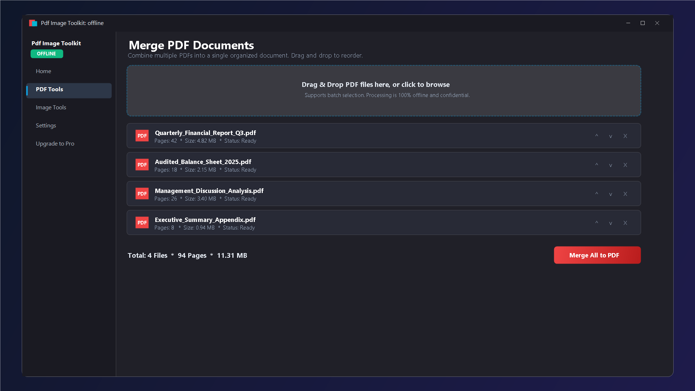
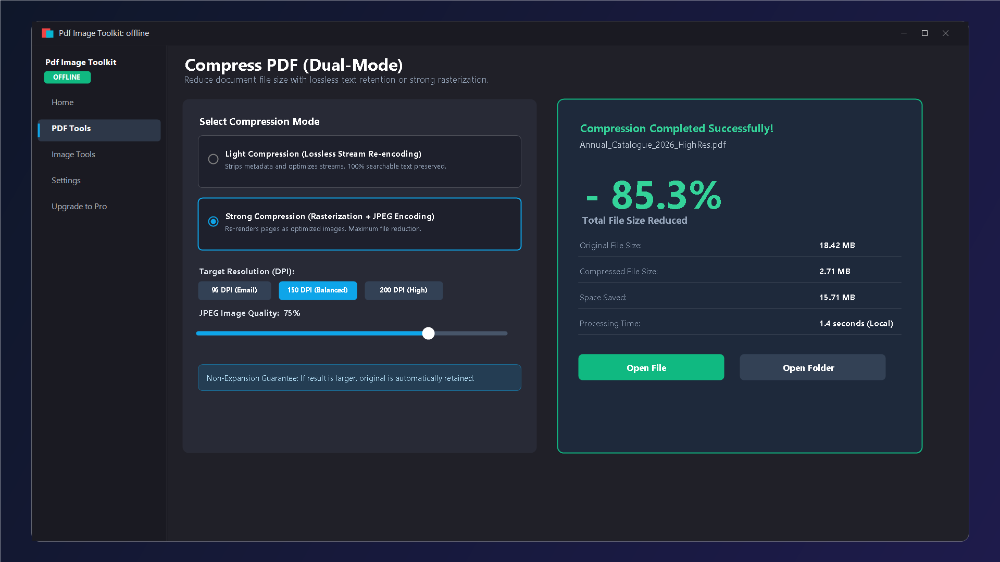
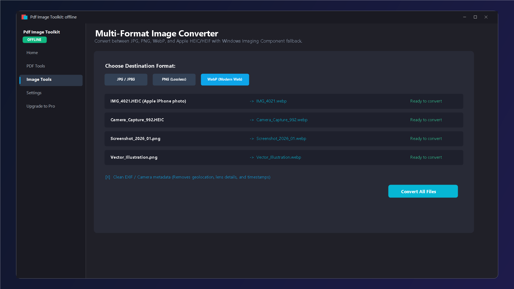
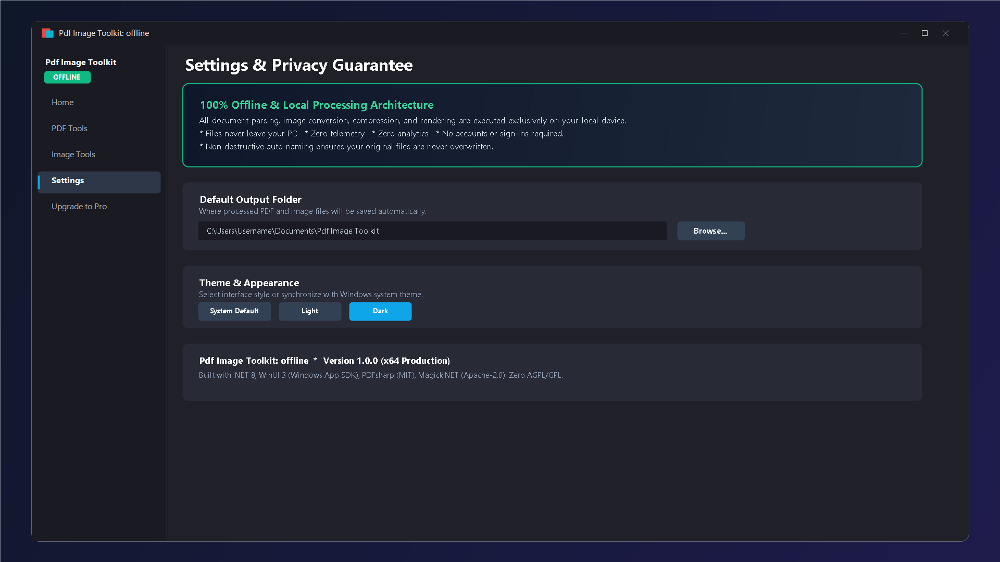

# Pdf Image Toolkit: offline

[](https://apps.microsoft.com/detail/9N40BWNB2JLQ)
[](https://dotnet.microsoft.com/)
[](https://learn.microsoft.com/windows/apps/winui/)
[](StoreSubmissionPackage/04_Listing_Metadata_and_Copy/PRIVACY_POLICY.md)
[](LICENSES.md)
[](https://apps.microsoft.com/detail/9N40BWNB2JLQ)

A production-quality, Microsoft Store-ready offline Windows 10/11 desktop application to merge, split, compress, and convert PDFs and images locally with total privacy.

[**Get it on Microsoft Store**](https://apps.microsoft.com/detail/9N40BWNB2JLQ) • [**Download Release**](https://github.com/Mrkalitaa/Pdf-Image-Toolkit-Offline/releases) • [**Privacy Policy**](StoreSubmissionPackage/04_Listing_Metadata_and_Copy/PRIVACY_POLICY.md)

---

## 📸 Screenshots

| Dashboard Overview | PDF Merge & Split |
| :---: | :---: |
|  |  |

| Dual-Mode PDF Compression | Batch Image Resize & Compress |
| :---: | :---: |
|  |  |

| Format Conversion (JPG, PNG, WebP, HEIC) | 100% Offline & Privacy First |
| :---: | :---: |
|  |  |

---

## 🌟 Key Product Features

- **100% Offline & Private**: All document and image processing is conducted entirely in local memory and private temporary storage. No telemetry, no analytics, no external network calls in application logic, and no user accounts required.
- **Modern Windows 11 Fluent UX**: Built with WinUI 3 (Windows App SDK 1.6) featuring Mica backdrop, seamless system light/dark theme adaptation, accessible controls, and drag-and-drop support.
- **Dual-Tier Entitlement (Free vs Pro)**:
  - **Free Tier**: 5 operations per day (resets automatically at local midnight), up to 10 files per batch, maximum 50 MB per file.
  - **Pro Edition**: Unlimited operations, unlimited batch processing, and unlimited file sizes. Integrated directly with the Microsoft Store (`Windows.Services.Store.StoreContext`, product ID `pro_unlock`).
  - **Developer Debug Toggle**: In `DEBUG` builds, toggle simulated Pro directly from the Settings page to test limits without making real Store transactions.
- **Non-Destructive Output Auto-Naming**: Automatically appends non-destructive suffixes (`file_merged.pdf`, `file_merged (1).pdf`) so user files are never overwritten.

---

## 🛠️ Architecture & Tech Stack

- **Framework**: C# / .NET 8 (`net8.0-windows10.0.26100.0`), Nullable reference types enabled, zero compiler warnings.
- **UI Platform**: WinUI 3 via Windows App SDK 1.6 (`1.6.250228001`, self-contained MSIX packaging).
- **Architecture**: MVVM using `CommunityToolkit.Mvvm` and `Microsoft.Extensions.DependencyInjection`.
- **PDF Engine**: PDFsharp 6.1.1 (MIT License) for merge, split, rotate, and images-to-PDF generation.
- **PDF Hardware Rasterizer**: `Windows.Data.Pdf` (built into Windows OS) for high-performance PDF rendering.
- **Image Processing Engine**: `Magick.NET-Q8-x64` 15.1.0 (Apache-2.0 License) for image compression, resizing, and format conversions (JPG, PNG, WebP, HEIC/HEIF with Windows Imaging Component fallback).
- **Testing**: xUnit 2.5.3 with fixtures generated in code.
- **Licensing Compliance**: Strictly permissive open-source licenses (MIT and Apache 2.0). Zero AGPL, GPL, or restrictive copyleft libraries used. See [`LICENSES.md`](LICENSES.md).

---

## 📁 Repository Structure

```
PdfImageToolkit/
├── PdfImageToolkit.sln                    # Main solution file
├── LICENSES.md                           # License documentation for all components
├── STORE_LISTING.md                      # Microsoft Store copy, keywords, and description
├── README.md                             # Engineering and Store submission guide
├── src/
│   ├── PdfImageToolkit.Core/             # Core domain models, interfaces, and processing engines
│   │   ├── Models/                       # FileItem, OperationProgress, OperationResult
│   │   ├── Services/                     # PdfService, ImageService, FileService, EntitlementService, SettingsService, LoggingService
│   │   └── Helpers/                      # PageRangeParser (handles "1-3,5", "5-2", "0", "99")
│   └── PdfImageToolkit.App/              # WinUI 3 packaged desktop application
│       ├── Assets/                       # Store and app logos (StoreLogo, Square44x44, Square150x150, Wide310x150, SplashScreen)
│       ├── Properties/PublishProfiles/   # win-x64.pubxml publishing profile
│       ├── Strings/en-US/                # Resources.resw for localization (English, prepared for Hindi & Assamese)
│       ├── ViewModels/                   # ShellViewModel, HomeViewModel, Pdf/, Image/, SettingsViewModel, UpgradeViewModel
│       ├── Views/                        # ShellView, HomeView, PdfToolsView, ImageToolsView, SettingsView, UpgradeView
│       └── Package.appxmanifest          # MSIX application manifest with minimal runFullTrust capability
└── tests/
    └── PdfImageToolkit.Tests/            # xUnit test suite with programmatic test fixtures
        ├── EntitlementTests.cs           # Daily quota (5 ops/day) & midnight reset validation
        ├── FileServiceTests.cs           # Auto-naming & directory handling
        ├── ImageToolsTests.cs            # Conversions, percentage/dimension resize, non-expansion compression
        ├── ImagesToPdfAndBackTests.cs    # Multi-page PDF generation & rasterization
        ├── PdfCompressTests.cs           # Light and strong compression tests
        ├── PdfMergeSplitRotateTests.cs   # Merge, split by range/page/chunk, page rotation
        └── RangeParserTests.cs           # Split range parser edge cases
```

---

## 🚀 Prerequisites

1. **Windows 10 (version 1809+) or Windows 11**.
2. **.NET 8.0 SDK** (version 8.0.400 or newer).
3. **Visual Studio 2022** (version 17.8 or newer) with the following workloads:
   - *.NET Desktop Development*
   - *Windows Application Development* (includes Windows App SDK and C# WinUI 3 templates)
4. **Windows App SDK 1.6** (installed automatically via NuGet).

---

## 🔨 Build Instructions

### 1. Build and Run in Development (Debug)

To build and run unpackaged or in Debug mode:

```powershell
# Restore dependencies and compile solution
dotnet build src/PdfImageToolkit.App/PdfImageToolkit.App.csproj -p:Platform=x64

# Launch the compiled executable directly
& "src/PdfImageToolkit.App/bin/x64/Debug/net8.0-windows10.0.26100.0/win-x64/PdfImageToolkit.App.exe"
```

### 2. Build the Production MSIX Package (Release)

To generate the self-contained Release MSIX package ready for sideloading or Store submission:

```powershell
dotnet publish src/PdfImageToolkit.App/PdfImageToolkit.App.csproj `
    -c Release `
    -p:Platform=x64 `
    /p:GenerateAppxPackageOnBuild=true
```

The resulting package will be output to:
`src/PdfImageToolkit.App/bin/x64/Release/net8.0-windows10.0.26100.0/win-x64/AppPackages/PdfImageToolkit.App_1.0.0.0_x64_Test/PdfImageToolkit.App_1.0.0.0_x64.msix`

---

## 🧪 Running Unit Tests

The test suite runs 29 automated tests covering PDF merging, page range parsing edge cases, compression non-expansion guarantees, image format conversions, and entitlement quota logic:

```powershell
dotnet test tests/PdfImageToolkit.Tests/PdfImageToolkit.Tests.csproj
```

Expected output:
```text
Passed!  - Failed: 0, Passed: 29, Skipped: 0, Total: 29
```

---

## 🏬 Microsoft Store Association Guide

Before uploading the final package to the Microsoft Store, associate the project with your reserved app name in Microsoft Partner Center:

1. Open `PdfImageToolkit.sln` in **Visual Studio 2022**.
2. In Solution Explorer, right-click the **`PdfImageToolkit.App`** project.
3. Select **Publish** > **Associate App with the Store...**
4. Sign in with your **Microsoft Partner Center** developer account.
5. Select your reserved app name (e.g., `PDF & Image Toolkit`).
6. Click **Next**, review the package identity details, and click **Associate**.
7. Visual Studio will automatically update `Package.appxmanifest` with your official:
   - `Package Name`
   - `Publisher ID` (CN=...)
   - `Publisher Display Name`
   - Visual Studio automatically imports your Store developer certificate.

---

## 🛡️ Running Windows App Certification Kit (WACK)

Microsoft requires all MSIX submissions to pass the Windows App Certification Kit (WACK) validation tests.

### Command-Line Execution

WACK is located in the Windows SDK directory:

```powershell
$wackExe = "C:\Program Files (x86)\Windows Kits\10\App Certification Kit\appcert.exe"
$msixPath = Resolve-Path "src/PdfImageToolkit.App/bin/x64/Release/net8.0-windows10.0.26100.0/win-x64/AppPackages/PdfImageToolkit.App_1.0.0.0_x64_Test/PdfImageToolkit.App_1.0.0.0_x64.msix"
$reportPath = "$HOME\Desktop\WackReport.xml"

& $wackExe test -apptype appx -packagepath $msixPath -reportoutputpath $reportPath
```

### Visual Studio GUI Execution

1. In Visual Studio, right-click `PdfImageToolkit.App` > **Publish** > **Create App Packages...**
2. Choose **Microsoft Store** or **Sideloading**.
3. Select Release `x64` configuration.
4. On the final confirmation dialog, check the box **Launch Windows App Certification Kit**.
5. Ensure all test categories pass:
   - ✅ Deployment and launch tests
   - ✅ Platform version compliance
   - ✅ Package manifest correctness (only `runFullTrust` capability)
   - ✅ Windows security features test
   - ✅ Supported API validation

---

## 📋 Microsoft Partner Center Submission Checklist

Follow this checklist to submit the application to the Microsoft Store:

### Phase 1: App Registration & Add-on Setup
- [ ] Log in to [Microsoft Partner Center](https://partner.microsoft.com/dashboard).
- [ ] Click **Create a new app** and reserve your chosen product title.
- [ ] In the app navigation sidebar, select **In-App Products** > **Create New In-App Product**.
- [ ] Select **Durable** add-on and configure:
  - **Product ID**: `pro_unlock` *(must match code identifier)*
  - **Display Name**: `PDF & Image Toolkit Pro`
  - **Pricing**: Set your one-time lifetime price (e.g. Tier 1: $4.99).
- [ ] Click **Submit to the Store** for the add-on so it is active when the app goes live.

### Phase 2: Store Listing & Marketing Assets
- [ ] In Partner Center, open **Store Listings** > **English (United States)**.
- [ ] Copy and paste the text from [`STORE_LISTING.md`](STORE_LISTING.md):
  - [ ] App Description & Features
  - [ ] Short Description (95 characters)
  - [ ] 7 Search Keywords
  - [ ] What's New notes (v1.0.0 Initial Release)
  - [ ] Privacy Policy text or URL
- [ ] Upload Store screenshots:
  - Minimum 1 desktop screenshot (`1920 × 1080` or `1366 × 768`).
  - Capture Home view, PDF Merge view, PDF Compress view, and Image Tools view.

### Phase 3: Package Build & Upload
- [ ] Associate project with the Store in Visual Studio (or manually verify `Package.appxmanifest` matches your Partner Center identity).
- [ ] Build the signed release bundle:
  ```powershell
  dotnet publish src/PdfImageToolkit.App/PdfImageToolkit.App.csproj -c Release -p:Platform=x64 /p:GenerateAppxPackageOnBuild=true
  ```
- [ ] In Partner Center > **Packages**, drag and drop the `.msix` or `.msixupload` package.
- [ ] Verify that Partner Center detects:
  - Target: Windows Desktop
  - Architecture: x64
  - Min Version: 10.0.17763.0

### Phase 4: Age Ratings & Submission
- [ ] Complete the IARC Age Rating questionnaire (Utility application, no user-generated content, no violence -> Rating: Everyone / 3+).
- [ ] Set Pricing & Markets (Worldwide or select target territories).
- [ ] Click **Submit to the Store**. Certification typically completes in 24 to 72 hours.
