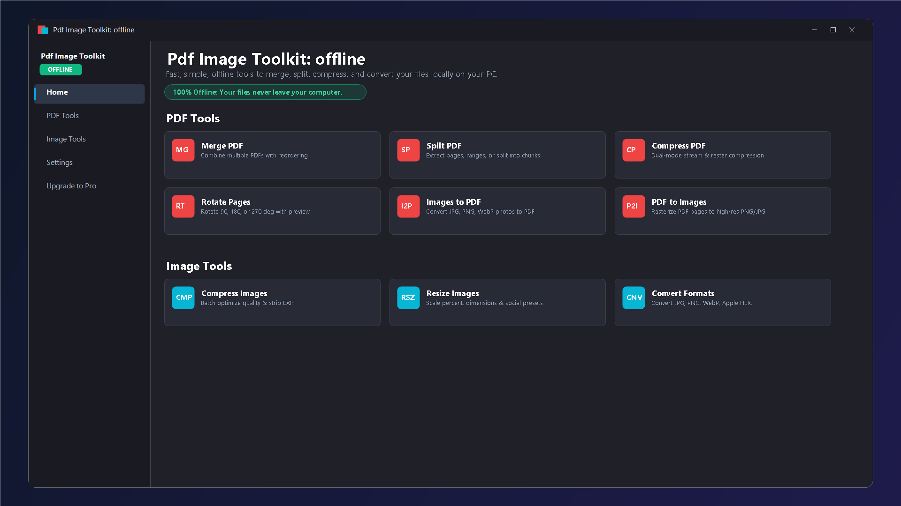
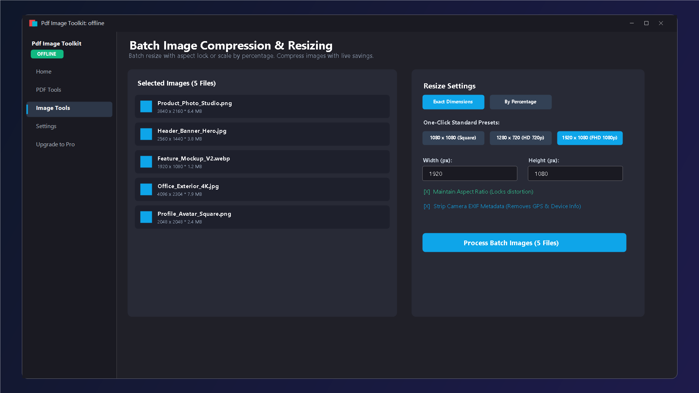

# 🚀 Pdf Image Toolkit: offline

**A fast, modern, and completely private Windows utility to merge, split, compress, and convert PDFs and images locally on your PC.**

[👉 Get it on the Microsoft Store](https://apps.microsoft.com/detail/9N40BWNB2JLQ) • [Features](#-key-features) • [PDF Tools](#-comprehensive-pdf-tools) • [Image Tools](#-high-performance-image-tools) • [Privacy Policy](PRIVACY_POLICY.md) • [FAQ](#-faq)

---

## 📸 Screenshots Showcase

### 1. Modern Dashboard (All-in-One Local Toolkit)

### 2. PDF Merge & Split with Drag-and-Drop Reordering

### 3. Dual-Mode PDF Compression (Light Searchable vs Strong Rasterized)

### 4. Batch Image Compression & Aspect-Locked Resizing

### 5. Multi-Format Image Converter (JPG, PNG, WebP, Apple HEIC)

### 6. Privacy First: 100% Offline & Local Processing Architecture

---

## ⚡ Key Features

Perform everyday PDF document and image tasks quickly and safely without uploading private contracts, financial statements, or personal photos to third-party cloud servers.

- 🛡️ **100% Offline & Private by Design:**
  - All processing is conducted exclusively in local PC memory (RAM).
  - Files never leave your computer.
  - Zero analytics, zero telemetry beacons, zero account sign-ins, and zero ads.

- 📄 **Comprehensive PDF Tools:**
  - **Merge PDFs:** Combine multiple documents into one organized file with drag-and-drop page reordering.
  - **Split PDFs:** Extract custom page ranges (`1-3, 5, 8-10`), extract every single page, or split into equal N-page chunks.
  - **Dual-Mode Compression:**
    - *Light Mode:* Re-encodes internal PDF streams and strips metadata while keeping 100% searchable text.
    - *Strong Mode:* High-efficiency rasterization with DPI selection (96, 150, 200) and JPEG quality slider for maximum size reduction.
    - *Non-Expansion Guarantee:* If compression ever produces a larger file, the original is automatically retained.
  - **Rotate Pages:** Orient scanned or upside-down pages by 90°, 180°, or 270°.
  - **Images to PDF:** Convert JPG, PNG, WebP, BMP, and Apple HEIC photos into multi-page PDFs with A4, Letter, or Fit-to-Image presets and custom margins.
  - **PDF to Images:** Rasterize full PDFs or specific page ranges into high-resolution PNG or JPG images at up to 300 DPI.

- 🖼️ **High-Performance Image Tools:**
  - **Compress Images:** Batch optimize photos with real-time size savings display and quality slider.
  - **Resize Images:** Batch resize by percentage (10% to 200%) or exact dimensions with aspect ratio lock to prevent distortion. Includes one-click presets: 1080×1080 (Square/Social), 1280×720 (HD), 1920×1080 (Full HD).
  - **Convert Formats:** Convert between JPG, PNG, WebP, and Apple HEIC/HEIF with built-in Windows Imaging Component fallback.
  - **Strip Metadata:** Optional toggle to remove camera EXIF data (GPS locations, camera serials, timestamps).

- 🪟 **Built for Windows 11 Fluent Design:**
  - Beautiful Mica backdrop material and light/dark theme synchronization.
  - Built with C# and .NET 8 on Windows App SDK with background async processing so the UI never freezes.
  - Non-destructive auto-naming protects original files from accidental overwrite.

---

## 📥 Download & Installation

The official and safest way to install is directly through the **Microsoft Store**:

### Why install via Microsoft Store?
- ✅ **Automatic silent background updates**
- ✅ **100% clean install and zero-residue uninstall**
- ✅ **Digitally signed and verified by Microsoft** (No SmartScreen warnings)
- ✅ **Free Trial available** (5 free operations per day)

---

## ❓ FAQ

<b>Does it upload my PDF documents or photos to the cloud?</b>

No. Absolutely nothing is uploaded. All document parsing, image conversion, compression, and rendering take place 100% locally on your PC. The application makes zero external network requests.

<b>Will compressing a file overwrite my original file?</b>

No. The application features non-destructive auto-naming. Your original file is never overwritten; outputs are saved with a clean suffix (e.g. <code>document_compressed.pdf</code>).

<b>What is the difference between Light and Strong PDF compression?</b>

Light compression re-encodes data streams and strips unneeded metadata, keeping your text 100% selectable and searchable. Strong compression rasterizes pages at your chosen DPI (96/150/200) for maximum file reduction (ideal for email attachments and scans).

<b>Can it convert Apple iPhone HEIC photos on Windows?</b>

Yes. The application supports batch conversion from Apple HEIC/HEIF to JPG, PNG, or WebP.

---

## 📄 License & Credits

- **Developer:** [MrKalita](https://apps.microsoft.com/detail/9N40BWNB2JLQ)
- **License:** [MIT License](LICENSE)
- **Privacy Policy:** [Privacy Policy](PRIVACY_POLICY.md)
- **Feedback & Issues:** Feel free to open an issue on the [Issues Tab](https://github.com/Mrkalitaa/Pdf-Image-Toolkit-Offline/issues).

---

**Enjoying Pdf Image Toolkit: offline? Give this repository a ⭐ to support development!**

[Download on the Microsoft Store](https://apps.microsoft.com/detail/9N40BWNB2JLQ)

